# 🚀 Microsoft Fabric Retail Sales Analytics
### End-to-End Data Engineering & Business Intelligence Solution


An end-to-end retail analytics solution built using **Microsoft Fabric, OneLake, Data Pipelines, PySpark, Delta Lake, SQL, and Power BI**.

The project transforms Wide World Importers (WWI) sales data into a curated analytical model and interactive business intelligence dashboards using a **Bronze–Silver–Gold medallion architecture**.

The solution demonstrates practical experience in data ingestion, transformation, dimensional modeling, financial reconciliation, advanced DAX, and enterprise-style BI reporting.

---

## 📌 Quick Navigation

- [Project Overview](#-project-overview)
- [Technology Stack](#-technology-stack)
- [Solution Architecture](#-solution-architecture)
- [Power BI Dashboard Gallery](#-power-bi-dashboard-gallery)
- [Data Engineering Implementation](#-data-engineering-implementation)
- [Semantic Model and Advanced DAX](#-semantic-model-and-advanced-dax)
- [Data Validation](#-data-validation)
- [Repository Structure](#-repository-structure)
- [Key Skills Demonstrated](#-key-skills-demonstrated)

---

## 📊 Project Overview

### Business Problem

Retail organizations need reliable, consolidated reporting to understand sales performance, profitability, customer activity, geographic distribution, and product trends.

Raw transactional data must be ingested, standardized, validated, and transformed into a business-ready analytical model before meaningful reporting can take place.

### Solution

This project implements a Microsoft Fabric data engineering pipeline and Power BI reporting solution.

**Key capabilities:**

- Bronze-layer ingestion of 14 source Parquet files.
- Silver-layer transformations using PySpark and Delta Lake.
- Gold-layer SQL views for business-ready reporting.
- Star-schema dimensional modeling.
- Advanced DAX for financial KPIs and time intelligence.
- Interactive dashboards with slicers and drill-down.
- Dynamic Field Parameters for flexible reporting.
- Data quality checks and financial reconciliation.

### Project Highlights

| Metric | Value |
|---|---:|
| Sales fact records | 228,265 |
| Customer dimension records | 403 |
| Product dimension records | 672 |
| Date dimension records | 1,461 |
| Gold SQL reporting views | 4 |
| Power BI report pages | 3 |
| Executive KPI cards | 5 |

---

## 🛠 Technology Stack

| Technology | Implementation |
|---|---|
| Microsoft Fabric | End-to-end analytics platform |
| Fabric Data Pipelines | Bronze-layer data ingestion |
| OneLake / Lakehouse | Centralized data storage |
| Apache Spark / PySpark | Silver-layer transformations |
| Delta Lake | Curated analytical tables |
| SQL Analytics Endpoint | Gold reporting views |
| Power BI Desktop | Semantic modeling and reporting |
| DAX | KPIs, time intelligence, conditional formatting |
| Power Query | Customer geography extraction |
| GitHub | Version control and project documentation |

---

## 🏗 Solution Architecture

```text
Wide World Importers Source Data
             |
             v
Microsoft Fabric Data Pipeline
             |
             v
BRONZE LAYER
OneLake / Lakehouse Files
14 Source Parquet Files
             |
             v
SILVER LAYER
PySpark + Delta Lake
Cleansing and Transformations
             |
             v
GOLD LAYER
SQL Analytics Endpoint
4 Business-Ready SQL Views
             |
             v
POWER BI DESKTOP
Import Semantic Model
Star Schema + Advanced DAX
             |
             v
INTERACTIVE REPORTING
Executive Sales Overview
Customer & Product Analytics
Detailed Sales Matrix
```

### Microsoft Fabric Workspace

The solution was developed in a dedicated Microsoft Fabric workspace containing the Lakehouse, Data Pipelines, Dataflow Gen2 items, transformation notebooks, SQL analytics endpoint, and semantic model.

[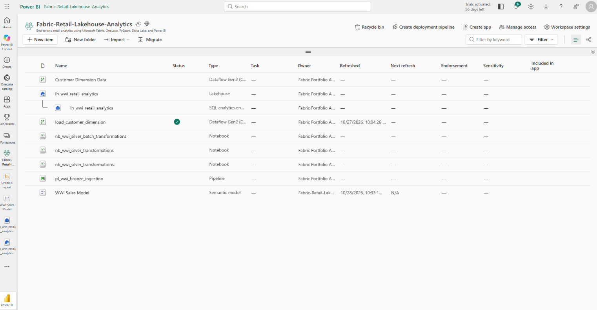](assets/screenshots/07_Fabric_Workspace_Overview.png)

---

## 📈 Power BI Dashboard Gallery

The reporting layer contains three interactive Power BI pages.

### 1. Executive Sales Overview

Executive reporting focused on financial performance, customer activity, and sales distribution.

**Features:**

- Net Sales
- Total Profit
- Profit Margin %
- Quantity Sold
- Active Customers
- Previous-month KPI comparisons
- Dynamic MoM indicators and conditional colors
- Monthly sales and profit trends
- Sales by customer state
- Top 5 customer locations by net sales
- Top 5 products by profit

[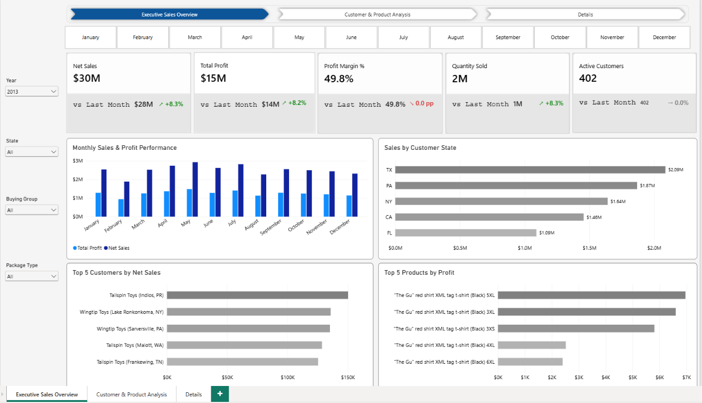](assets/screenshots/01_Executive_Sales_Overview.png)

### 2. Customer & Product Analytics

Additional analysis of revenue, profitability, sales volume, and customer buying groups.

**Features:**

- Monthly profit trends
- Monthly net sales trends
- Quantity sold by buying group
- Net sales by packaging type
- Year, month, state, and buying group filtering

[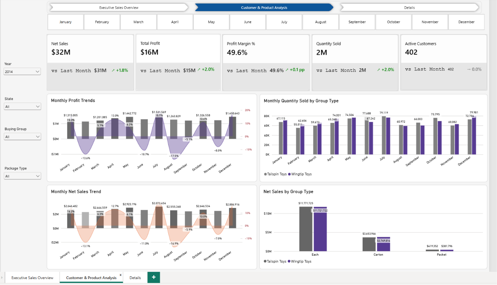](assets/screenshots/02_Customer_Product_Analytics.png)

### 3. Interactive Details Matrix

A detailed analytical reporting page designed for flexible exploration of customer and product performance.

**Features:**

- Drillable sales matrix
- Dynamic Field Parameters
- Customer and product attributes
- Revenue and profitability measures
- Interactive filters and conditional formatting

[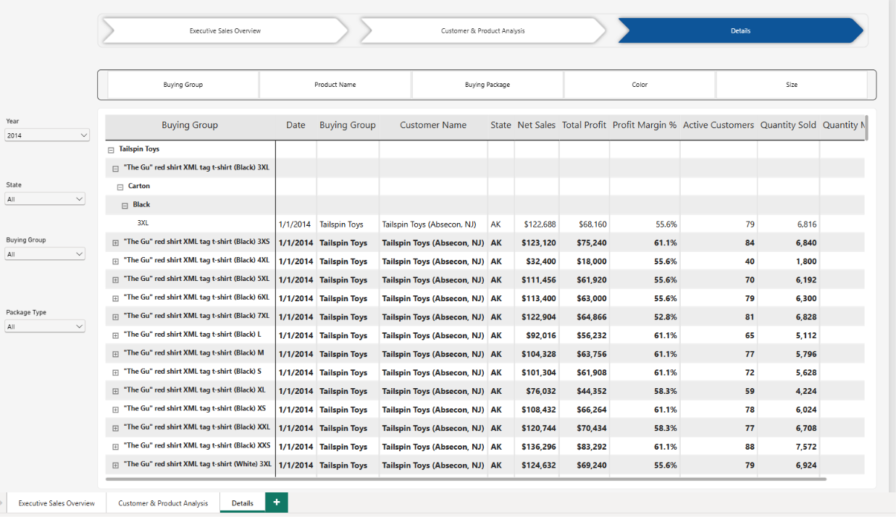](assets/screenshots/03_Interactive_Details_Matrix.png)

#### Dynamic Field Parameters

Field Parameters allow users to change reporting dimensions without rebuilding the visual.

[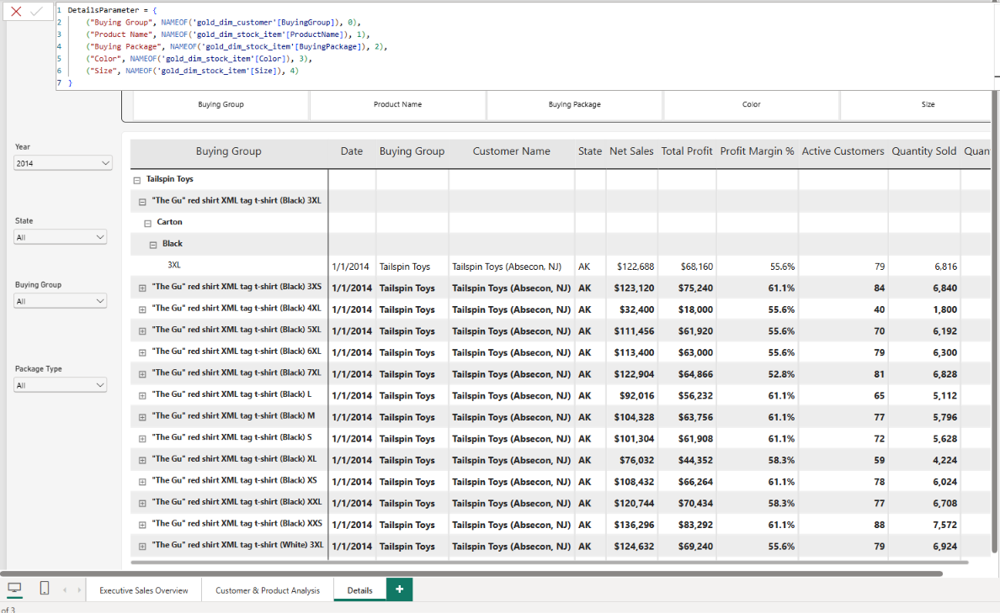](assets/screenshots/04_Dynamic_Field_Parameters.png)

---

## ⚙️ Data Engineering Implementation

### Bronze Layer — Data Ingestion

The Bronze layer uses a Microsoft Fabric Data Pipeline to ingest source Parquet files into the Lakehouse.

**Pipeline:** `pl_wwi_bronze_ingestion`

**Landing path:** `Files/wwi-raw-data/`

[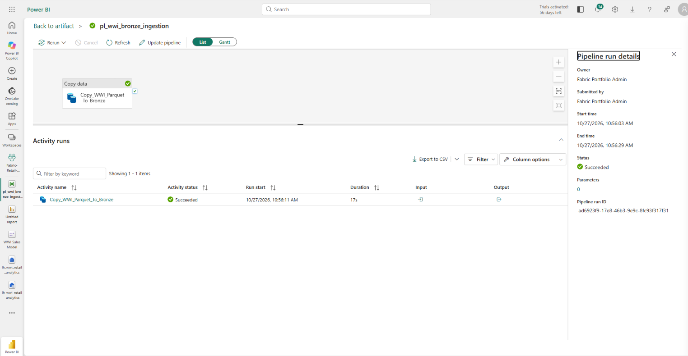](assets/screenshots/08_Fabric_Bronze_Pipeline.png)

[Explore Data Ingestion Documentation](01-Data-Ingestion/README.md)

### Silver Layer — PySpark and Delta Lake

The Silver layer processes Bronze data into curated Delta tables.

| Silver Table | Records |
|---|---:|
| silver_dim_customer | 403 |
| silver_dim_city | 116,295 |
| silver_dim_stock_item | 672 |
| silver_dim_date | 1,461 |
| silver_fact_sale | 228,265 |

Transformation activities include column standardization, data cleansing, business-rule application, and validation.

#### Lakehouse Structure

[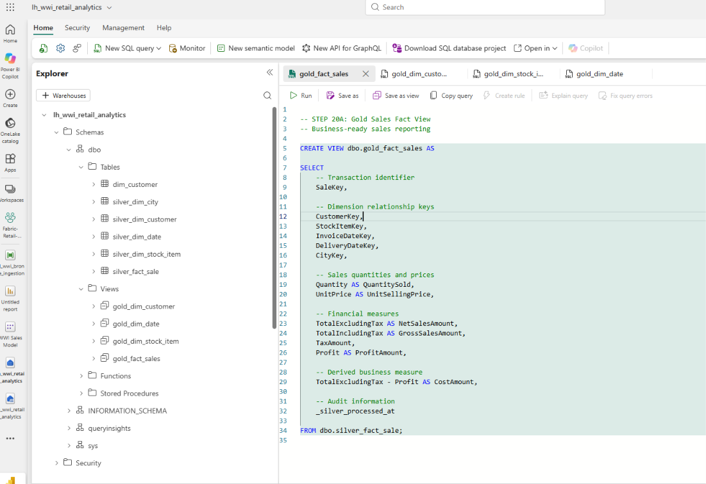](assets/screenshots/09_Fabric_Lakehouse.png)

#### PySpark Transformations

[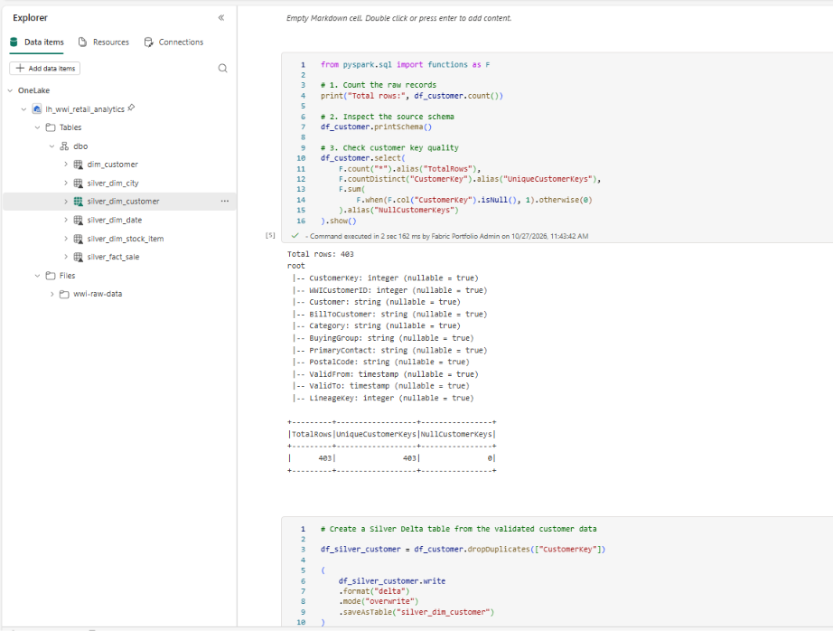](assets/screenshots/10_Silver_PySpark_Transformations.png)

[Explore Data Engineering Documentation](02-Data-Engineering/README.md)

[View Silver Transformation Notebook](02-Data-Engineering/WWI_Silver_Transformations.ipynb)

### Gold Layer — SQL Analytics

The Gold layer exposes curated SQL views from the Silver Delta tables.

| Gold View | Purpose |
|---|---|
| gold_fact_sales | Revenue, cost, profit, quantity |
| gold_dim_customer | Customer attributes |
| gold_dim_stock_item | Product attributes |
| gold_dim_date | Calendar and fiscal attributes |

**SQL source files:**

- [Sales Fact View](03-Gold-SQL/gold_fact_sales.sql)
- [Customer Dimension View](03-Gold-SQL/gold_dim_customer.sql)
- [Product Dimension View](03-Gold-SQL/gold_dim_stock_item.sql)
- [Date Dimension View](03-Gold-SQL/gold_dim_date.sql)

[Explore Gold SQL Documentation](03-Gold-SQL/README.md)

---

## 🧠 Semantic Model and Advanced DAX

Power BI Desktop connects to the curated Gold SQL views using **Import mode**.

The model follows a star schema with a central sales fact table and related customer, product, and date dimensions.

### Star Schema

[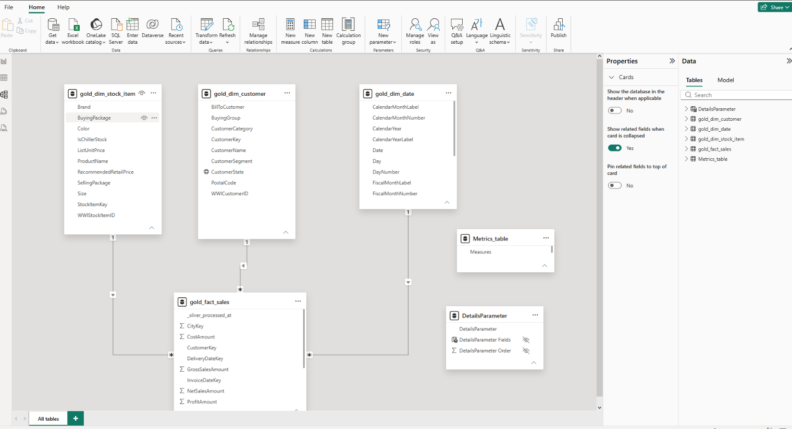](assets/screenshots/05_Star_Schema_Model.png)

### Core DAX Measures

```dax
Net Sales =
SUM('gold_fact_sales'[NetSalesAmount])

Total Profit =
SUM('gold_fact_sales'[ProfitAmount])

Profit Margin % =
DIVIDE([Total Profit], [Net Sales])

Quantity Sold =
SUM('gold_fact_sales'[QuantitySold])

Active Customers =
DISTINCTCOUNT('gold_fact_sales'[CustomerKey])
```

### Time Intelligence

Previous-month calculations use the date dimension and DAX time-intelligence functions.

```dax
LM Net Sales =
CALCULATE(
    [Net Sales],
    DATEADD('gold_dim_date'[Date], -1, MONTH)
)

Net Sales MoM % =
DIVIDE(
    [Net Sales] - [LM Net Sales],
    [LM Net Sales]
)
```

Additional measures provide dynamic KPI arrows, percentage changes, and conditional colors.

### DAX Organization

Measures are organized into display folders to support readability and maintenance.

[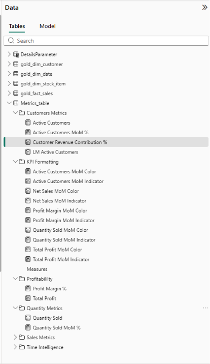](assets/screenshots/06_DAX_Measures.png)

[Explore Power BI Documentation](04-Power-BI/README.md)

---

## ✅ Data Validation

The solution includes validation of record counts, dimension keys, and financial totals between Silver and Gold.

### Financial Reconciliation

| Metric | Validated Total |
|---|---:|
| Net Sales | $172,261,341.20 |
| Gross Sales | $198,043,439.45 |
| Total Profit | $87,291,809.90 |
| Total Cost | $86,532,160.30 |
| Sales Fact Rows | 228,265 |

The validation process confirmed that financial totals in the Gold reporting layer matched the corresponding Silver data.

[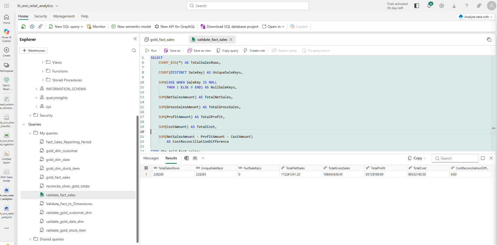](assets/screenshots/11_Gold_SQL_Validation.png)

**Reporting note:** The date dimension covers 2013–2016, while available sales transactions extend through May 2016. Therefore, 2016 represents a partial sales year.

---

## 📁 Repository Structure

```text
Microsoft-Fabric-Retail-Sales-Analytics/
|
|-- README.md
|
|-- 01-Data-Ingestion/
|   `-- README.md
|
|-- 02-Data-Engineering/
|   |-- README.md
|   `-- notebooks/
|       `-- WWI_Silver_Transformations.ipynb
|
|-- 03-Gold-SQL/
|   |-- README.md
|   |-- gold_fact_sales.sql
|   |-- gold_dim_customer.sql
|   |-- gold_dim_stock_item.sql
|   `-- gold_dim_date.sql
|
|-- 04-Power-BI/
|   `-- README.md
|
`-- assets/
    `-- screenshots/
        |-- 01_Executive_Sales_Overview.png
        |-- 02_Customer_Product_Analytics.png
        |-- 03_Interactive_Details_Matrix.png
        |-- 04_Dynamic_Field_Parameters.png
        |-- 05_Star_Schema_Model.png
        |-- 06_DAX_Measures.png
        |-- 07_Fabric_Workspace_Overview.png
        |-- 08_Fabric_Bronze_Pipeline.png
        |-- 09_Fabric_Lakehouse.png
        |-- 10_Silver_PySpark_Transformations.png
        `-- 11_Gold_SQL_Validation.png
```

---

## 🎯 Key Skills Demonstrated

**Data Engineering**
- Microsoft Fabric Lakehouse architecture
- Data Pipeline orchestration
- PySpark transformations
- Delta Lake processing
- Bronze–Silver–Gold medallion design

**SQL and Data Modeling**
- SQL reporting views
- Dimensional modeling
- Star-schema relationships
- Data validation and reconciliation
- Business-ready analytical datasets

**Business Intelligence**
- Power BI Desktop and Import modeling
- Advanced DAX and time intelligence
- KPI design and conditional formatting
- Dynamic Field Parameters
- Interactive dashboards and drill-down

**End-to-End Delivery**
- Data ingestion through analytical reporting
- Data quality validation
- Technical documentation
- GitHub project publication

---

## 🔐 Security and Availability

The Power BI PBIX file is intentionally not distributed publicly.

The repository provides SQL definitions, transformation notebooks, architecture documentation, and screenshots to demonstrate the implementation.

Microsoft Fabric workspace access and source connections are not required to browse the documentation.

---

## 📌 Project Summary

This project demonstrates the development of an end-to-end Microsoft Fabric analytics solution, from raw data ingestion to curated SQL reporting views and interactive Power BI dashboards.

It highlights practical experience across **data engineering, SQL, dimensional modeling, DAX, and business intelligence delivery**.

---

**Built with Microsoft Fabric, PySpark, Delta Lake, SQL, and Power BI.**
